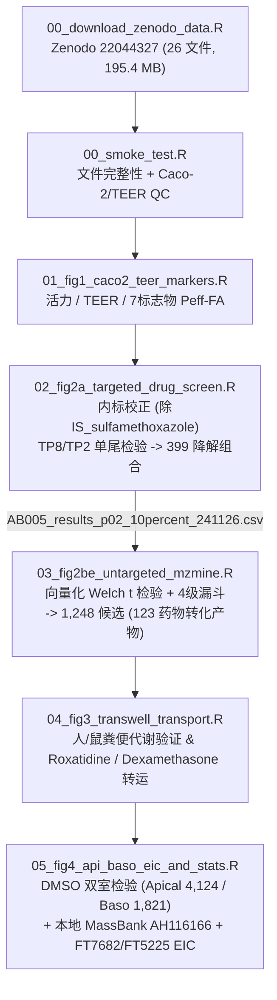
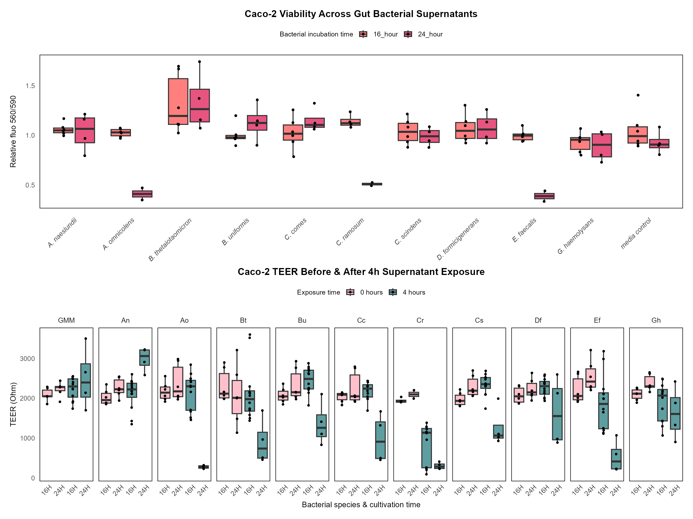
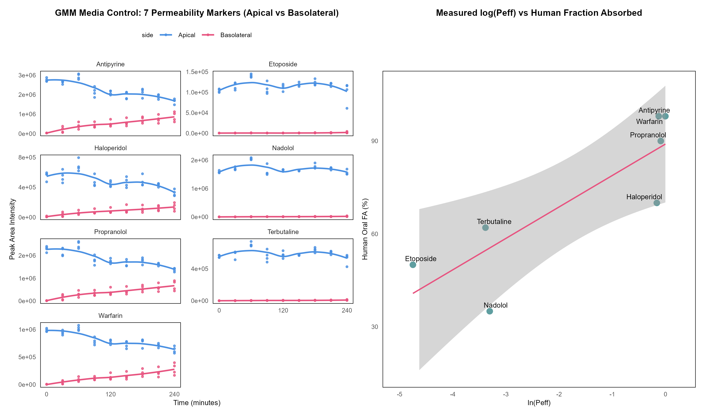
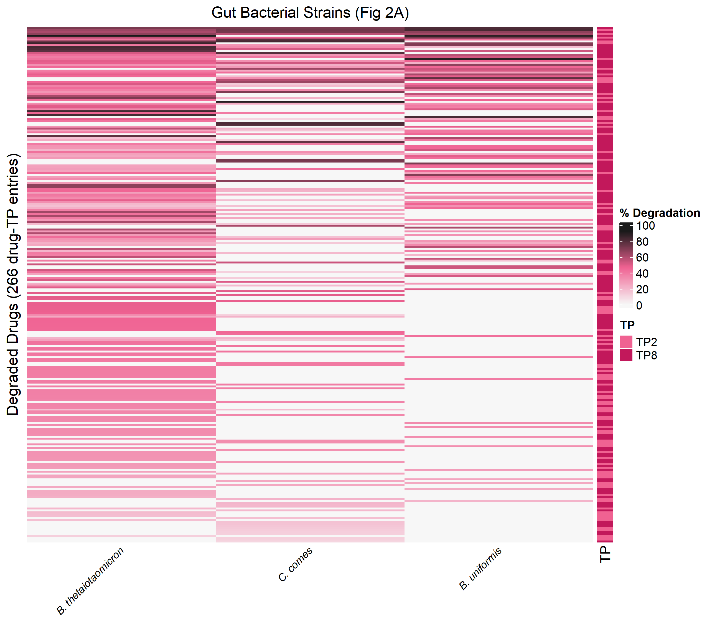
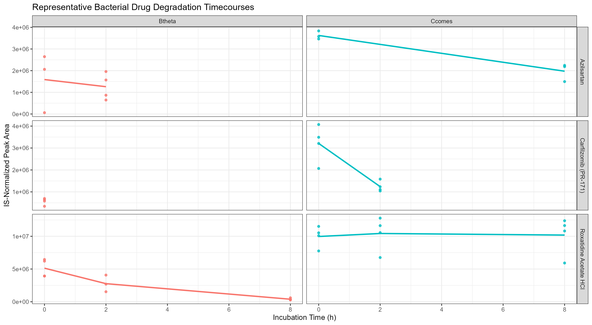
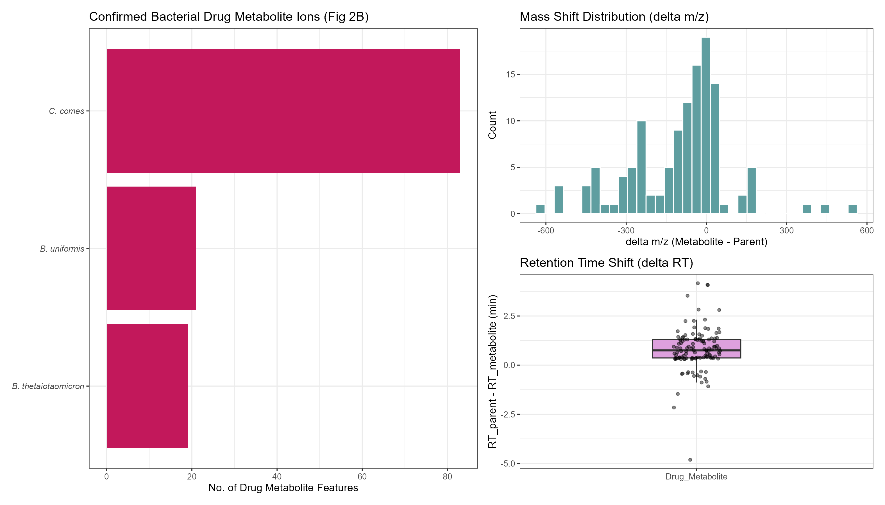
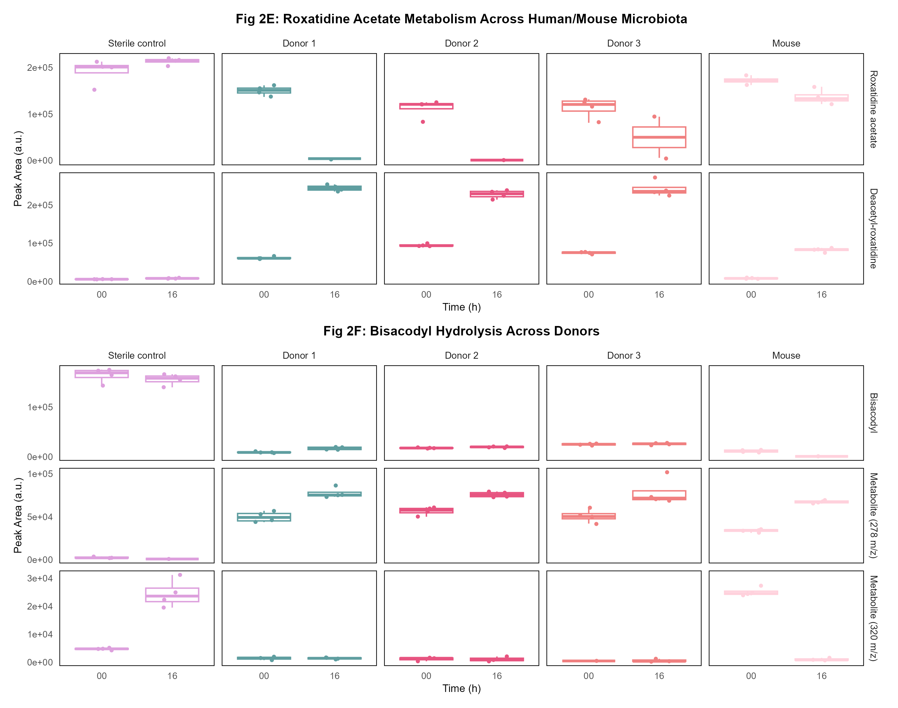
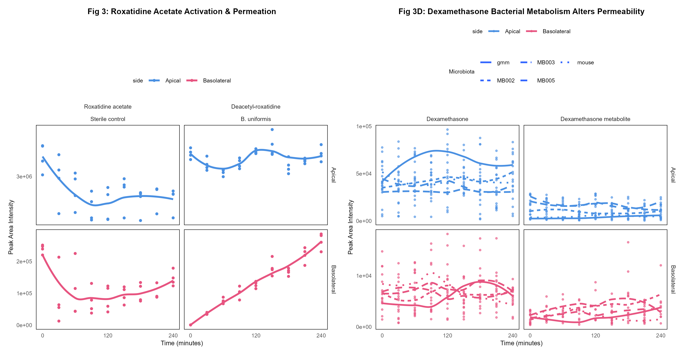
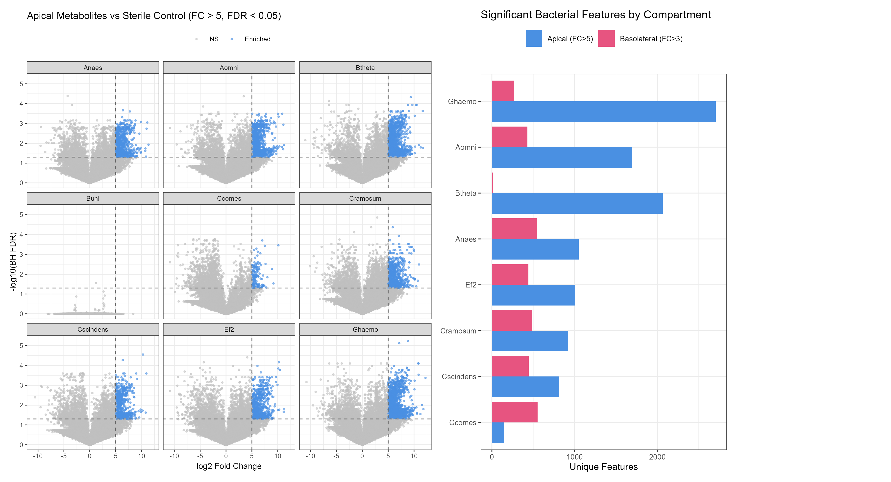
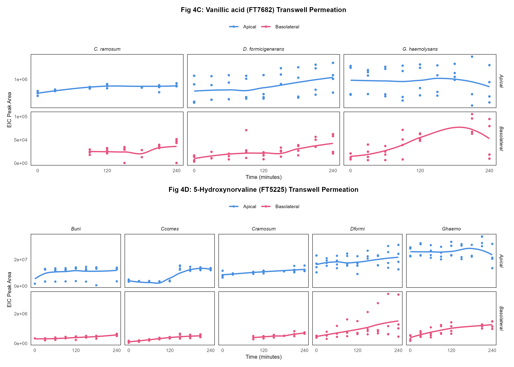

# transwell_2026: 肠道菌群代谢物上皮通透性（Transwell）全流程复现工程

[](https://www.r-project.org/)
[](https://bioconductor.org/)
[-green.svg)](https://zenodo.org/records/22044327)
[](https://doi.org/10.1101/2025.06.10.658935)
[](#5-复现结果图画廊与量化验收)

> **论文出处**：*Establishing an in vitro pipeline for the high-throughput quantification of epithelial permeability of gut bacterial metabolites* (*bioRxiv*, 2025-06, DOI: [`10.1101/2025.06.10.658935`](https://doi.org/10.1101/2025.06.10.658935))  
> **原作者仓库**：[ZimmermannLab/transwell_2026](https://github.com/ZimmermannLab/transwell_2026)  
> **公开输入数据**：[Zenodo Record 22044327](https://zenodo.org/records/22044327)（26 个文件，共 `195.4 MB`）  
> **技术复盘与面试沉淀**：[docs/transwell_2026_项目复盘与STAR话术.md](./docs/transwell_2026_项目复盘与STAR话术.md)

---

## 目录
1. [目录结构与文件夹作用](#1-目录结构与文件夹作用)
2. [原作者工作与上游脚本映射](#2-原作者工作与上游脚本映射)
3. [复现工程流水线与一键运行](#3-复现工程流水线与一键运行)
4. [复现问题与工程解决方法](#4-复现问题与工程解决方法)
5. [复现结果图画廊与量化验收](#5-复现结果图画廊与量化验收)
6. [运行环境与工具软件包清单](#6-运行环境与工具软件包清单)

---

## 1. 目录结构与文件夹作用

```tree
reproduction/metabolomics/transwell_2026/
├── README.md                                   # 本项目全景复现主入口导览（当前文件）
├── input_folder/
│   └── README.md                               # 26 个 Zenodo 下载表 + AB005 同步表的全量字节/行列/字段字典
├── data/
│   ├── README.md                               # 数据总览与外部受控资源 (MTBLS12528 / MiMeDB) 合规替代边界说明
│   └── processed/
│       ├── README.md                           # 5 个中间处理产物说明（含 2.27 GB TP8_ttest_results.RDS 等）
│       ├── 02_fig2a_norm_df.rds                # Step 02 导出：内标校正后的 AB005 靶向全表 (248 KB)
│       ├── TP8_ttest_results.RDS               # Step 03 缓存：11 株菌 × ~449 药向量化 Welch 检验结果 (2.27 GB)
│       ├── 240607_mzmine_candidates.csv        # Step 03 导出：1,248 条池特异性候选特征与产物分类表 (266 KB)
│       ├── AB007_api_ttest_candidates.csv      # Step 05 导出：DMSO Apical 显著菌源特征 + MassBank 注释 (1.57 MB)
│       └── AB007_baso_ttest_candidates.csv     # Step 05 导出：DMSO Basolateral 显著菌源特征 + MassBank 注释 (544 KB)
├── envs/
│   └── install_packages.R                      # 无 Java/xlsx 依赖的 CRAN + Bioconductor 检查与安装脚本
├── repro_scripts/
│   ├── run_all.R                               # 一键总调度器 (--mode smoke / --mode phase2 / --mode full)
│   ├── 00_download_zenodo_data.R               # 修复 draft token 404 后自动拉取公开 Zenodo 22044327
│   ├── 00_smoke_test.R                         # <5s 冒烟检验（包加载 + 文件齐全性 + Caco-2/TEER QC）
│   ├── 01_fig1_caco2_teer_markers.R            # Fig 1: 活力、TEER 恢复、7 标志物转运与 Peff-FA 相关性
│   ├── 02_fig2a_targeted_drug_screen.R         # Fig 2A: 内标校正、449 药池降解热图与 AB005 清单生成
│   ├── 03_fig2be_untargeted_mzmine.R           # Fig 2B-E: 11 株菌向量化 Welch t 检验与 4 级漏斗挖掘
│   ├── 04_fig3_transwell_transport.R           # Fig 2E-F & Fig 3: 粪便菌群验证、Roxatidine & Dexamethasone 转运
│   └── 05_fig4_api_baso_eic_and_stats.R        # Phase 2 / Fig 4: DMSO 双室非靶向检验 + MassBank 注释 + 双室 EIC
├── repro_results/                              # 10 张核心高分辨复现图、TSV 汇总表与 environment_versions.tsv
├── upstream_transwell_2026/                    # 原作者 GitHub 仓库浅克隆对照（含 15 个原始脚本，.gitignore 屏蔽）
├── docs/                                       # 技术复盘与 STAR 面试问答
└── logs/                                       # sessionInfo() 快照与运行记录
```

> **目录清理说明**：上游零散脚本原本会在根目录新建 `Plot/`、`Plots/`、`Env/`、`output/`、`EIC_output/` 等多个杂乱输出目录；本次标准化工程中已全部统一收敛至 `repro_results/` 与 `data/processed/` 并清除了冗余空目录。

---

## 2. 原作者工作与上游脚本映射

论文建立了一套高通量体外筛选体系，将 **11 株代表性人源肠道共生菌**（*A. naeslundii*, *A. omnicolens*, *B. thetaiotaomicron*, *B. uniformis*, *C. comes*, *C. ramosum*, *C. scindens*, *D. formicigenerans*, *E. faecalis*, *G. haemolysans* + 无菌对照 *nobug*）分别与 **481 种临床药物**（按正交混合分成 26 池，每药分布于 4 个唯一池）或 **DMSO** 共同孵育，再将无菌滤过的细菌上清液作用于 **Caco-2 肠上皮细胞单层 Transwell 模型**，结合靶向定量与 MZmine 非靶向组学，系统揭示细菌药物转化与内源代谢物跨越肠上皮屏障的规律。

上游 `upstream_transwell_2026/` 共包含 15 个分散于根目录的 `.R`/`.Rmd` 文件，本工程将其重构并整合为标准化流水线：

| 上游原始脚本 (`upstream_transwell_2026/`) | 原著职责 | 复现工程归属与改进说明 |
|---|---|---|
| `download_zenodo_inputs.R` + `zenodo_utils.R` | 下载 Zenodo 输入表 | **`00_download_zenodo_data.R`**：修复失效的 draft preview token URL，保留 `zenodo_utils.R` 下载校验内核 |
| `Fig1_TEER_viability_script.R` / `Fig1E_Cell_viability&TEER.R` / `Fig1F_markers_transwell1.R` | 96 孔筛选细胞活力/TEER、24 孔恢复及 7 种标准物通透计算 | **`01_fig1_caco2_teer_markers.R`**：三合一模块化重构，彻底移除 `library(xlsx)` 对本地 Java 的强依赖 |
| `Fig2A_tardrug_analysis_pipeline.R` | AB005 药物池靶向峰积分内标校正与降解热图 | **`02_fig2a_targeted_drug_screen.R`**：输出标准化表与代表性时程图，并同步生成供下游读取的 `AB005_results_...csv` |
| `Fig2B_E_untar_analysis.Rmd` | 11 株菌非靶向 MZmine 代谢转化产物 4 级筛选 | **`03_fig2be_untargeted_mzmine.R`**：修复 `TP8_ttest_results.RDS` 断链，`matrixStats` 向量化提速，修复菌株别名错配 |
| `Fig2EF_Drugassay.R` / `Fig3_plots.R` / `Fig3_bisacodyl.R` / `Fig3D_transwell_drugs.R` | 人/鼠粪便菌群转化验证及 Roxatidine / Bisacodyl / Dexamethasone 双室转运 | **`04_fig3_transwell_transport.R`**：四合一重构；新增 `parse_targeted_csv()` 兼容多版本前置列结构；规避 `showtext` 硬编码字体路径 |
| `Fig4_analysis.R` + `compare_tonnobug_mzmine.R` + `Fig4CD_plots.R` (+ `EIC_all_*_function.R`) | DMSO 双室统计、MiMeDB 注释与 `.mzML` EIC 绘制 | **`05_fig4_api_baso_eic_and_stats.R`**：合规替代受控 `MTBLS12528`/`MiMeDB`，实现向量化双侧检验 + 本地 MassBank 注释 + 预提 EIC 复现 |
| `Fig1_marker_analysis.R` | 补充批次 `AB012G1–G6` 标志物辅助检验 | 已记录于 `input_folder/README.md`，主线集中使用核心 Transwell 1 数据 |

---

## 3. 复现工程流水线与一键运行

### 3.1 自动化全流程示意图



### 3.2 一键运行指令

```powershell
# 1. 仅检查依赖状态（CRAN + Bioconductor，无需 Java JDK）
Rscript reproduction/metabolomics/transwell_2026/envs/install_packages.R --dry-run

# 2. 如果 input_folder 为空，自动拉取公开 Zenodo 数据集
Rscript reproduction/metabolomics/transwell_2026/repro_scripts/00_download_zenodo_data.R

# 3. 按需执行冒烟测试 / 第二阶段 Fig 4 / 完整全流程 (01 -> 05)
Rscript reproduction/metabolomics/transwell_2026/repro_scripts/run_all.R --mode smoke
Rscript reproduction/metabolomics/transwell_2026/repro_scripts/run_all.R --mode phase2
Rscript reproduction/metabolomics/transwell_2026/repro_scripts/run_all.R --mode full
```

---

## 4. 复现问题与工程解决方法

1. **Zenodo 预览 Token 404 断链**：原著 `download_zenodo_inputs.R` 硬编码审稿期 `/draft?preview=1&token=...` 接口，随着 Zenodo 归档公开转为正式记录后返回 `HTTP 404`。在 [00_download_zenodo_data.R](./repro_scripts/00_download_zenodo_data.R) 中改传正式 URL `https://zenodo.org/records/22044327` 后成功下载全部 26 个文件。
2. **Windows `xlsx` / `rJava` 强依赖阻塞**：原著 `Fig1E_Cell_viability&TEER.R` 顶部声明了 `library(xlsx)`，导致无本地 JDK 环境无法加载，而代码中实际完全调用的是 `readxl::read_excel()`。重构后彻底移除 `xlsx` 依赖。
3. **断链缓存 `TP8_ttest_results.RDS` 与算力瓶颈**：原著 `Fig2B_E_untar_analysis.Rmd` 将保存 `TP8_ttest_results.RDS` 的行注释掉却在后文直接读取；且嵌套循环调用 `stats::t.test()` 面对 11 株菌 × ~449 药 × 11k–25k 特征耗时极长。在 [03_fig2be_untargeted_mzmine.R](./repro_scripts/03_fig2be_untargeted_mzmine.R) 中用 `matrixStats::colVars` 重构**矩阵向量化 Welch t 检验**（随机抽样与 `stats::t.test` 最大 $P$ 值差异仅 **`1.11e-16`**），现场生成并缓存 `data/processed/TP8_ttest_results.RDS`（`2.27 GB`）。
4. **跨模块菌株别名不一致与产物漏检**：`Fig2A` 靶向表采用 `Buniformis` 与 `Efaecalis`，而 `MZMINE` 矩阵采用 `Buni` 与 `Ef2`。未经映射直接连接会遗漏 `B. uniformis` 的全部药物转换产物（仅检出 `102` 条）；在 `03` 通过 `recode()` 显式对齐后完整恢复至 **`123` 条** confirmed `Drug_Metabolite`。
5. **靶向 CSV 多格式前置列与 Windows `showtext` 字体路径报错**：`AB012_drugs_mets_table.csv` 有 5 个前置元数据列，而 `Data_AB012I_transwell_drugs.csv` 仅 1 个；同时原著多处写死 `showtext::font_add("arial.ttf")` 导致报错。在 [04_fig3_transwell_transport.R](./repro_scripts/04_fig3_transwell_transport.R) 中实现 `parse_targeted_csv()` 基于 `"Results"` 位置和首行 `"Name"` 标记动态定位样本列，并统一使用 `family = "sans"` 系统字体。
6. **Phase 2 (`Fig 4`) 受控数据与缺失数据库合规边界**：实测原始谱图 `MTBLS12528` 在 EBI FTP 公开路径返回 `404`（API 返回无权限），且 `mimedb.org` 返回 `403 Forbidden`。在严守访问控制的前提下，[05_fig4_api_baso_eic_and_stats.R](./repro_scripts/05_fig4_api_baso_eic_and_stats.R) 直接利用 Zenodo 中的全量双室定量矩阵 `mzmine_dmso_api_baso__quant.csv`（`35,434 × 102`）搭配本地缓存 **MassBank (`AH116166`)** `CompDb` 完成中性质量匹配注释，并用预提表 `FT7682_ion.csv` / `FT5225_ion.csv` 重绘双室 EIC 曲线。

---

## 5. 复现结果图画廊与量化验收

### 5.1 各阶段实测结果汇总

| 流程阶段 | 核心验收指标 | 本机实测结果 | 输出产物 |
|---|---|---|---|
| **00 冒烟验证** | Zenodo 输入完整性与屏障中位数 | 7/7 核心表 + 11 组 `MZMINE` 就绪；活力中位数 `1.024`；TEER `2121.0 -> 2101.5 Ohm` | `00_smoke_qc.png`、`00_smoke_verification_summary.tsv` |
| **01 Fig 1 屏障质控** | 7 种参照药 $P_{\text{eff}}$ 与人类 `FA%` 正相关 | 低通透组 (`Etoposide 0.00865`, `Terbutaline 0.0339`, `Nadolol 0.0367`) 与高通透组 (`Haloperidol 0.849`, `Warfarin 0.881`, `Propranolol 0.915`, `Antipyrine 0.998`) 清晰分化 1–2 个数量级 | `01_fig1_viability_and_teer.png`、`01_fig1_ab012i_viability_teer.png`、`01_fig1_markers_and_peff.png`、`01_fig1_peff_summary.tsv` |
| **02 Fig 2A 靶向筛选** | 449 种临床药显著降解热图 | 检出 **`399` 条**降解组合（覆盖 **`195` 种独立药物**：`Btheta` TP8 `127`/TP2 `67`、`Buniformis` TP8 `71`/TP2 `27`、`Ccomes` TP8 `71`/TP2 `36`） | `02_fig2a_drug_degradation_heatmap.png`、`02_fig2a_example_timecourses.png`、`02_fig2a_degraded_drugs_results.tsv` |
| **03 Fig 2B–E 挖掘** | 4 级漏斗非靶向药物代谢产物 | `101,038` $\rightarrow$ `67,877` $\rightarrow$ `5,647` $\rightarrow$ **`1,248` 候选**（确认 **`123` 个**细菌药物转化产物 + `1,125` 生理变化） | `03_fig2be_untargeted_summary.png`、`03_fig2be_mzmine_candidates.tsv` |
| **04 Fig 2E–F & Fig 3** | 粪便验证与双室药物转运 | 复现 Human Donor 1–3 与 Mouse 粪便对 Roxatidine / Bisacodyl 的代谢转换，以及 `Roxatidine` / `Dexamethasone` 顶侧与基底侧渗透曲线 | `04_fig2ef_microbiota_drug_assays.png`、`04_fig3_bisacodyl_and_dexamethasone.png`、`04_fig3_dexamethasone_summary.tsv` |
| **05 Phase 2 / Fig 4** | DMSO 双室组学 + MassBank + EIC | 检出 Apical **`4,124`**（`10,394` 条，MassBank 命中 `945`）/ Basolateral **`1,821`** 唯一显著特征（`3,178` 条，命中 `789`），完整召回 `FT7682`、`FT5225`、`FT2029` 等原文标志峰并绘制 Vanillic acid / 5-HNV 双室 EIC | `05_fig4_api_baso_volcano_and_counts.png`、`05_fig4cd_vanillic_acid_and_5hnv_eic.png`、`05_fig4_api_ttest_candidates.tsv`、`05_fig4_baso_ttest_candidates.tsv` |

### 5.2 核心复现结果图展示

1. **Caco-2 活力、TEER 恢复与 7 种参考化合物 $P_{\text{eff}}$ 标定 (`Fig 1`)**：

   
   

2. **11 株肠道细菌 × 449 种药物靶向降解热图与代表性时程曲线 (`Fig 2A`)**：

   
   

3. **非靶向 MZmine 药物转换产物鉴定分布 (`Fig 2B–E`)**：

   

4. **人类/小鼠供体粪便验证与 Roxatidine / Dexamethasone Transwell 双室渗透 (`Fig 2E–F & Fig 3`)**：

   
   

5. **Phase 2 (`Fig 4`): DMSO 顶侧/基底侧菌源特征火山图及 Vanillic acid / 5-HNV EIC 渗透曲线**：

   
   

> 其余辅助图（`00_smoke_qc.png`、`01_fig1_ab012i_viability_teer.png`）与全量定量表均保存在 [`repro_results/`](./repro_results/)。

---

## 6. 运行环境与工具软件包清单

全部实际使用软件包版本已记录于 [repro_results/environment_versions.tsv](./repro_results/environment_versions.tsv) 与 [logs/sessionInfo.txt](./logs/sessionInfo.txt)：

| 类别 | 软件包 | 实测版本 | 来源仓库 | 在本工程中的核心用途 |
|---|---|---|---|---|
| **核心语言** | `R` | `4.6.0` | Base R | Windows x64 运行环境 |
| **高性能计算与表格** | `data.table` | `1.18.6.1` | CRAN | 高速读写 11 个 11–26 MB `MZMINE` 矩阵与矩阵转置 |
| | `matrixStats` | `1.5.0` | CRAN | `colVars()` 向量化不等方差 Welch t 检验（消除 4,900+ 次循环瓶颈） |
| | `tidyverse` / `plyr` / `reshape2` / `fuzzyjoin` | `2.0.0` / `1.8.9` / `1.4.5` / `0.1.8` | CRAN | 数据清洗、长宽表转换与分组连接 |
| | `readxl` / `openxlsx` / `jsonlite` | `1.6.0` / `4.2.9` / `2.0.0` | CRAN | 读写 `.xlsx` (替代需 JDK 的 `xlsx`) 与解析 Zenodo REST API |
| **绘图与热图** | `ComplexHeatmap` | `2.28.0` | Bioconductor 3.23 | 绘制 Fig 2A 195 种降解药物聚类/分类热图 |
| | `ggplot2` / `patchwork` / `cowplot` / `gridExtra` | `4.0.3` / `1.3.2` / `1.2.0` / `2.3.1` | CRAN | 多面板排版与分组箱线/LOESS 曲线绘制 |
| | `ggforce` / `hrbrthemes` / `gplots` / `RColorBrewer` / `showtext` / `scales` | `0.5.0` / `0.9.3` / `3.3.0` / `1.1.3` / `0.9.8` / `1.4.0` | CRAN | 科学计数轴格式、配色板与分面增强 |
| **质谱与注释** | `AnnotationHub` / `CompoundDb` | `4.2.2` / `1.16.0` | Bioconductor 3.23 | Phase 2 本地加载 MassBank `AH116166` `CompDb` 执行中性质量匹配 |
| | `xcms` / `MSnbase` / `mzR` / `BiocParallel` / `Biobase` | `4.10.1` / `2.38.1` / `2.46.0` / `1.46.0` / `2.72.0` | Bioconductor 3.23 | 原生 `.mzML` 兼容基础设施与并行接口 |
| **工程辅助** | `here` / `rmarkdown` | `1.0.2` / `2.32` | CRAN | 工作区路径与上游 `.Rmd` 文档工具 |
