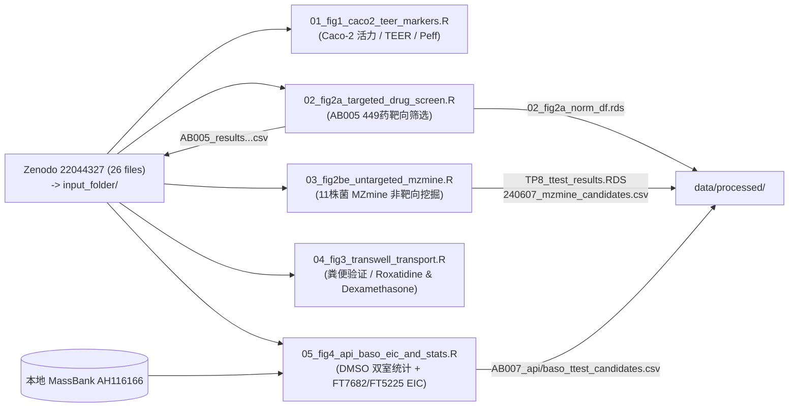

# `transwell_2026` 数据架构与获取总览 (`data/`)

本项目数据分为两层管理，分别位于：

1. **[`../input_folder/`](../input_folder/README.md)**（`195.4 MB`，26 个 Zenodo 原始文件 + 1 个运行期同步表）：详尽的逐文件尺寸、行列维度、列名与实验编码规范请直接查阅 [**input_folder/README.md**](../input_folder/README.md)。
2. **[`./processed/`](./processed/README.md)**（`~2.27 GB`，5 个阶段中间结果）：由 `02`、`03`、`05` 复现脚本现场生成并缓存的统计检验结果与候选特征表，详见 [**data/processed/README.md**](./processed/README.md)。

---

## 1. 公开数据与外部受控数据边界

| 数据资产 | 来源与状态 | 复现工程中的处理方式 |
|---|---|---|
| **Zenodo Record `22044327`**（26 文件） | ✅ 已公开发布（原著脚本中的 `/draft?preview=1&token=...` 已随转正失效） | 由 [00_download_zenodo_data.R](../repro_scripts/00_download_zenodo_data.R) 通过公开 URL `https://zenodo.org/records/22044327` 自动完整拉取至 `input_folder/` |
| **`TP8_ttest_results.RDS`** | ⚠️ 上游未附带（原著 `.Rmd` 将计算与保存行注释掉） | 由 [03_fig2be_untargeted_mzmine.R](../repro_scripts/03_fig2be_untargeted_mzmine.R) 使用 `matrixStats::colVars` 向量化 Welch t 检验现场重算并缓存至 `data/processed/TP8_ttest_results.RDS`（抽样 $P$ 值最大偏差 `1.11e-16`） |
| **`AB005_results_p02_10percent_241126.csv`** | ⚠️ 上游脚本现场导出 | 由 [02_fig2a_targeted_drug_screen.R](../repro_scripts/02_fig2a_targeted_drug_screen.R) 现场生成并自动同步到 `input_folder/` 供 Step 03 读取 |
| **`Mapping_BugDrug_all_binary.csv`** | ❌ 未随 Zenodo `22044327` 打包上传 | `02` 核心降解筛选与热图不依赖该扩展历史对比表，因此核心 Fig 2A 复现无损 |
| **MetaboLights `MTBLS12528` 原始 `.mzML`** | 🔒 **受控 / 未公开**（实测 EBI FTP 返回 `404`，WS API 返回无权限） | **严守访问控制边界**：不绕过任何权限限制；Fig 4 的全量特征统计直接使用 Zenodo 中的 `mzmine_dmso_api_baso__quant.csv`（`35,434 × 102`），核心代谢物 EIC 直接使用 Zenodo 提供的预提取峰坐标表 `FT7682_ion.csv` 与 `FT5225_ion.csv` |
| **`mimedb_metabolites_v20240319.csv`** | 🔒 `mimedb.org` 返回 `403 Forbidden` 且未随 Zenodo 上传 | [05_fig4_api_baso_eic_and_stats.R](../repro_scripts/05_fig4_api_baso_eic_and_stats.R) 改用本地 `BiocFileCache` 缓存的 **MassBank (`AnnotationHub AH116166`)** `CompDb` 执行中性质量匹配（`max(0.002 Da, 20 ppm)`）作为合规等价替代注释库 |

---

## 2. 数据 $\rightarrow$ 脚本流转关系简图

